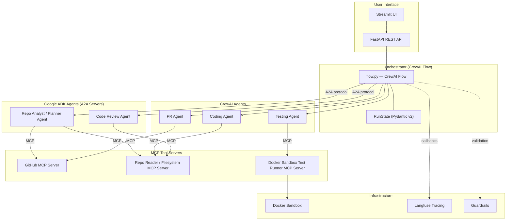
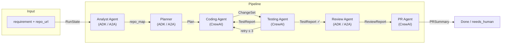

# RepoAgent Architecture

> An agentic AI system that takes a natural-language requirement and produces
> a tested, reviewed GitHub Pull Request for human approval.

## High-Level Pipeline

```
Requirement → Understand → Plan → Code → Test → Correct → Review → Create PR
```

There is **no** separate Debugging Agent. Test failures are routed back to the
Coding Agent with a capped retry count (`max_retries=3`), after which the run
stops with status `needs_human`.

---

## System Diagram



## Data Flow



## Agent Responsibilities

| Agent | Framework | Protocol | Responsibility |
|-------|-----------|----------|----------------|
| **Repo Analyst / Planner** | Google ADK | A2A Server | Reads repo structure, understands codebase, produces `Plan` |
| **Coding Agent** | CrewAI | Direct (in-flow) | Generates `ChangeSet` from `Plan`, handles corrections |
| **Testing Agent** | CrewAI | Direct (in-flow) | Runs tests in Docker sandbox, produces `TestReport` |
| **Code Review Agent** | Google ADK | A2A Server | Reviews changes, produces `ReviewReport` with verdict |
| **PR Agent** | CrewAI | Direct (in-flow) | Creates GitHub PR, produces `PRSummary` |

## MCP Tool Servers

| MCP Server | Purpose | Used By |
|------------|---------|---------|
| **GitHub MCP** | Read repos, create branches, open PRs, read issues | Analyst, PR Agent |
| **Repo Reader / Filesystem** | Read file contents, list directories, search code | Analyst, Coder, Reviewer |
| **Docker Sandbox Test Runner** | Execute tests safely inside isolated Docker containers | Testing Agent |

## Module Layout

```
src/repoagent/
├── schemas.py           # Pydantic v2 shared models (RunState, Plan, etc.)
├── flow.py              # CrewAI Flow orchestrator
├── providers/           # LLM provider configuration
├── agents/
│   ├── crewai/          # Coding, Testing, PR agents
│   └── adk/             # Analyst/Planner, Code Review agents
├── a2a/                 # A2A protocol servers & clients
├── mcp_servers/         # MCP tool server implementations
├── guardrails/          # Input/output validation, security checks
├── callbacks/           # Task monitoring, logging callbacks
├── observability/       # Langfuse integration, tracing
├── api/                 # FastAPI REST endpoints
└── ui/                  # Streamlit dashboard
```

## Evaluation Criteria Mapping

The table below maps each of the 11 teacher evaluation criteria to the specific
module(s) and mechanisms that will satisfy it.

| # | Criterion | Module / Mechanism | Details |
|---|-----------|-------------------|---------|
| 1 | **Context sharing and state updates between agents** | `schemas.py` → `RunState` + `flow.py` | Single Pydantic `RunState` object shared across all agents via the CrewAI Flow. Each agent reads/writes specific fields. State mutations are validated via `validate_assignment=True`. |
| 2 | **Tool integration via MCP (≥ 2 external tools)** | `mcp_servers/` | Three MCP servers: GitHub (repo/PR ops), Repo Reader (filesystem), Docker Sandbox (test execution). All conform to the Model Context Protocol spec. |
| 3 | **Structured final output with Pydantic (JSON + Markdown)** | `schemas.py` | All inter-agent data uses Pydantic v2 models. Final outputs (`PRSummary`, `ReviewReport`) serialize to both JSON (`model_dump_json()`) and Markdown (template rendering). |
| 4 | **Suitable agentic design patterns** | `flow.py`, `agents/` | Orchestrator pattern (CrewAI Flow), Tool-use pattern (MCP), Reflection/correction loop (test→code retry), Structured output pattern (Pydantic). |
| 5 | **Task monitoring and logging via callback functions** | `callbacks/` | Custom callback handlers attached to CrewAI agents and ADK agents. Log step transitions, token usage, errors, and timing to both console and Langfuse. |
| 6 | **Agent-to-agent communication with A2A protocol** | `a2a/` | ADK agents (Analyst, Reviewer) are served as A2A servers. The CrewAI Flow orchestrator communicates with them via A2A client SDK, enabling cross-framework agent communication. |
| 7 | **Use BOTH CrewAI and Google ADK** | `agents/crewai/`, `agents/adk/` | CrewAI: Coding, Testing, PR agents + Flow orchestrator. Google ADK: Repo Analyst/Planner, Code Review agents. No other agentic frameworks used. |
| 8 | **Guardrails and callbacks for security and data validation** | `guardrails/` | Input sanitization (prompt injection defense), secret detection (no credentials in generated code), branch name enforcement (`repoagent/<run_id>`), Pydantic validation on all agent I/O, sandbox isolation for code execution. |
| 9 | **Observability and tracing (Langfuse)** | `observability/` | Langfuse SDK v5 integration for distributed tracing. Every agent step, LLM call, and tool invocation is traced. Dashboards for latency, token usage, and error rates. |
| 10 | **End-to-end performance evaluation** | `eval/` | Evaluation harness that measures: total wall-clock time, per-agent latency, LLM token consumption, cost estimates, retry rates, and success/failure classification. Results stored as structured JSON. |
| 11 | **Cloud deployment** | `Dockerfile`, `docker-compose.yml`, cloud config | Containerized deployment with Docker Compose. FastAPI serves the REST API, Streamlit provides the UI. Deployable to GCP Cloud Run / AWS ECS / Azure Container Apps. |

## Security Invariants

1. **Never push to `main`** — all work on `repoagent/<run_id>` branches
2. **Never auto-merge** — PRs are created for human approval only
3. **Sandbox isolation** — generated code runs only inside Docker containers
4. **Secrets management** — all secrets from env vars / `.env` (gitignored), never logged or committed
5. **Retry cap** — maximum 3 correction iterations, then `needs_human` status

## Technology Stack

| Layer | Technology | Version |
|-------|-----------|---------|
| Language | Python | ≥ 3.11 |
| Agentic (orchestration) | CrewAI | 1.15.28 |
| Agentic (specialized agents) | Google ADK | 2.12.0 |
| Agent communication | A2A SDK | 1.2.2 |
| Tool protocol | MCP Python SDK | 2.3.0 |
| Observability | Langfuse | 5.0.2 |
| Data models | Pydantic | 2.11.7 |
| REST API | FastAPI | 0.115.12 |
| UI | Streamlit | 1.45.1 |
| HTTP client | httpx | 0.28.1 |
| Container mgmt | docker-py | 7.2.1 |
| GitHub API | PyGithub | 2.6.1 |
| Linting | ruff | 0.11.13 |
| Testing | pytest | 8.4.1 |
